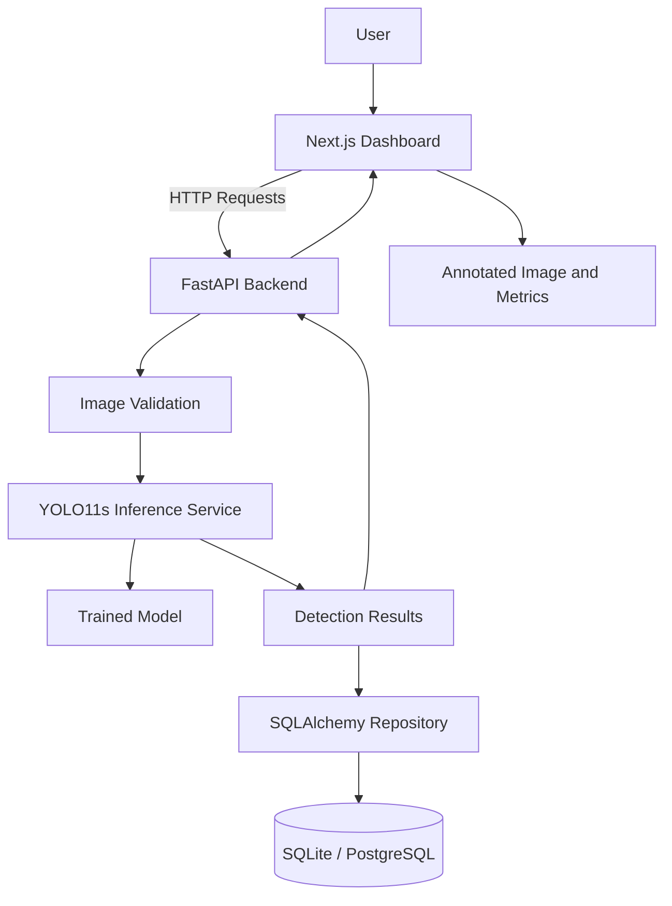

# VisionGuard-AI

### Pedestrian Detection with YOLO11 | MOT17 | Deep Learning Research & Full-Stack Application

VisionGuard-AI is a computer vision project focused on detecting pedestrians in surveillance-style images using the YOLO11 object detection framework.

The project combines a reproducible deep learning research workflow with a full-stack application that allows users to upload images, run object detection, inspect bounding boxes, and review previously saved predictions.

The research component covers dataset preparation, model fine-tuning, controlled experiments, validation-based model selection, held-out test evaluation, and failure analysis. The application provides a FastAPI inference service and a Next.js dashboard for interacting with the selected model.

---

## Project Overview

| Category | Details |
|---|---|
| Project | VisionGuard-AI |
| Task | Pedestrian Object Detection |
| Dataset | MOT17 Pedestrian Subset |
| Classes | 1 — Person |
| Total Images | 2,000 |
| Selected Model | YOLO11s LR Tuned |
| Training Framework | PyTorch + Ultralytics |
| Training Environment | Google Colab — NVIDIA Tesla T4 |
| Backend | FastAPI |
| Frontend | Next.js, React, TypeScript |
| Database | SQLite / PostgreSQL |
| Deployment | Docker Compose |

### Key Results

| Metric | Validation | Held-out Test |
|---|---:|---:|
| Precision | 83.94% | 80.03% |
| Recall | 49.10% | 43.19% |
| F1-score | 61.96% | 56.10% |
| mAP@0.50 | 59.31% | 50.39% |
| mAP@0.50:0.95 | 30.17% | 31.03% |

The final checkpoint was selected using validation results. The held-out test set was used only for final evaluation.

---

## Table of Contents

1. [Project Objectives](#project-objectives)
2. [Features](#features)
3. [System Architecture](#system-architecture)
4. [Dataset](#dataset)
5. [Model Training and Experiments](#model-training-and-experiments)
6. [Evaluation Results](#evaluation-results)
7. [Failure Analysis](#failure-analysis)
8. [Technology Stack](#technology-stack)
9. [Repository Structure](#repository-structure)
10. [Installation and Setup](#installation-and-setup)
11. [Docker Deployment](#docker-deployment)
12. [API Reference](#api-reference)
13. [Configuration](#configuration)
14. [Limitations and Future Work](#limitations-and-future-work)
15. [Reproducibility](#reproducibility)
16. [Academic Information](#academic-information)
17. [Dataset and Third-Party Licenses](#dataset-and-third-party-licenses)

---

## Project Objectives

The main objectives of VisionGuard-AI are:

1. Prepare and validate a real-world pedestrian detection dataset.
2. Fine-tune pretrained YOLO11 object detection models.
3. Investigate how model architecture, image resolution, and learning rate affect detection performance.
4. Compare experimental results using standardized validation metrics.
5. Select the best-performing checkpoint using validation results.
6. Evaluate the selected model on an independent test set.
7. Analyze detection errors and identify practical improvements.
8. Build a full-stack application for real-world image inference.

The project focuses on understanding the complete object detection workflow, from data preparation and model training to evaluation and application integration.

---

## Features

### Deep Learning and Computer Vision

- YOLO11-based pedestrian detection.
- Transfer learning using pretrained weights.
- MOT17 annotation conversion to YOLO format.
- Sequence-based dataset splitting.
- Dataset integrity and annotation validation.
- Multiple training and hyperparameter experiments.
- Precision, Recall, F1-score, and mAP evaluation.
- Validation-based model selection.
- Held-out test evaluation.
- Prediction visualization and failure analysis.

### Web Application

**Dashboard**
- Overview of detection activity.
- Model information and readiness.
- Recent detection records.

**Image Detection**
- Upload or drag and drop images.
- Configure confidence and IoU thresholds.
- Detect pedestrians using the trained YOLO11s model.
- View bounding boxes and confidence scores.
- Download annotated prediction images.

**Detection History**
- Browse previously processed images.
- Search records by filename.
- Inspect individual detection results.
- Delete saved detection records.

**Analytics**
- Visualize detection activity.
- Review saved detection statistics.

**Model Information**
- View model details.
- Inspect validation and test metrics.
- Review inference configuration.

The application currently supports a single detection class: `person`. It is designed for image-based inference rather than live video tracking.

---

## System Architecture



### Request Lifecycle

1. A user uploads an image through the dashboard.
2. The frontend sends the image to the FastAPI backend.
3. The backend validates the image format, dimensions, and file size.
4. The inference service processes the image using the loaded YOLO11s checkpoint.
5. The model generates pedestrian bounding boxes and confidence scores.
6. The backend creates an annotated image and records the detection results.
7. Detection metadata is saved in the database.
8. The frontend displays the prediction and makes the saved record available through detection history.

The model is loaded once during application startup. Inference uses CUDA when available and falls back to CPU otherwise.

---

## Dataset

### MOT17 Pedestrian Dataset

The project uses the pedestrian annotations from the MOT17 dataset.

- Official dataset: [MOTChallenge — MOT17](https://motchallenge.net/data/MOT17/)
- Dataset mirror used during preparation: [Lekim89/MOT17 — Hugging Face](https://huggingface.co/datasets/Lekim89/MOT17)

MOT17 is a multi-object tracking benchmark containing surveillance-style video sequences and pedestrian annotations.

For this project, the pedestrian detection task was extracted from the original annotations and converted into YOLO object detection format.

### Detection Class

| Class ID | Class Name |
|---:|---|
| 0 | Person |

The original pedestrian class ID was mapped to YOLO class ID `0`.

### Dataset Split

A custom sequence-based split was created to prevent frames from the same source sequence from appearing in multiple splits.

| Split | MOT17 Sequences | Images | Person Annotations |
|---|---|---:|---:|
| Training | 02, 04, 05, 09 | 1,200 | 28,390 |
| Validation | 10 | 400 | 7,854 |
| Testing | 11, 13 | 400 | 5,216 |
| **Total** | **7 sequences** | **2,000** | **41,460** |

### Data Preparation

The dataset preparation workflow included:

- Extracting pedestrian annotations.
- Converting bounding boxes into normalized YOLO coordinates.
- Assigning class ID `0` to every pedestrian.
- Sampling frames deterministically from each source sequence.
- Keeping source sequences separate across dataset splits.
- Clipping bounding boxes that crossed image boundaries.
- Checking image-label correspondence.
- Validating annotation coordinates and dimensions.

The saved dataset audit reported:

- Zero corrupt images.
- Zero missing labels.
- Zero invalid annotations in the final processed dataset.
- 5,138 clipped annotations.
- One discarded invalid annotation.

The final processed dataset contains 41,460 valid pedestrian annotations.

The split was created using a deterministic sampling procedure. Training randomness used seed `42`.

**Important:** This is a custom MOT17 subset and evaluation split. It is not an official MOTChallenge benchmark evaluation.

Raw dataset images are not included in the repository. Users must obtain the dataset from an authorized source and follow the original dataset terms.

---

## Model Training and Experiments

### Training Framework

The project uses the Ultralytics YOLO11 object detection framework with pretrained weights.

Transfer learning was used to adapt pretrained detection models to the pedestrian detection task.

### Baseline Model

The baseline model was YOLO11n, initialized from pretrained `yolo11n.pt` weights.

| Parameter | Configuration |
|---|---|
| Architecture | YOLO11n |
| Image Size | 640 |
| Batch Size | 8 |
| Epochs | 15 |
| Optimizer | Auto |
| Random Seed | 42 |
| Training Device | NVIDIA Tesla T4 |
| Training Time | 8.75 minutes |

### Controlled Experiment

One controlled experiment investigated the effect of reducing input image resolution.

The image size was changed from 640 to 512 while keeping the dataset split, pretrained initialization, batch size, training duration, and other planned settings fixed.

**Hypothesis:** Reducing image resolution may decrease training time and computational requirements, but could reduce the ability to detect small or distant pedestrians.

| Parameter | Baseline | Experiment |
|---|---:|---:|
| Model | YOLO11n | YOLO11n |
| Image Size | 640 | 512 |
| Batch Size | 8 | 8 |
| Epochs | 15 | 15 |
| Optimizer | Auto | Auto |
| Random Seed | 42 | 42 |
| Training Time | 8.75 min | 7.22 min |

### Additional Experiments

Further experiments investigated fine-tuning, model capacity, and learning-rate selection.

| Experiment | Model | Learning Rate | Training Time |
|---|---|---:|---:|
| Baseline | YOLO11n | Auto | 8.75 min |
| Image-size experiment | YOLO11n | Auto | 7.22 min |
| Refined model | YOLO11n | 0.0005 | 7.07 min |
| Model-size comparison | YOLO11s | Auto | 6.74 min |
| Learning-rate experiment | YOLO11s | 0.0005 | 10.43 min |

The YOLO11s learning-rate experiment used AdamW and a lower learning rate of `0.0005`, compared with the corresponding initial YOLO11s setup.

The final selected model was **YOLO11s LR Tuned**.

It was selected based on its validation performance, not on the held-out test results.

### Validation Comparison

All models were compared using a standardized validation evaluation configuration:

- Image size: 640
- Confidence threshold: 0.001
- NMS IoU threshold: 0.70

| Model | Precision | Recall | F1 | mAP@50 | mAP@50:0.95 |
|---|---:|---:|---:|---:|---:|
| **YOLO11s LR Tuned** | **0.8394** | **0.4910** | **0.6196** | **0.5931** | **0.3017** |
| YOLO11s | 0.7541 | 0.4575 | 0.5695 | 0.5504 | 0.2685 |
| YOLO11n — 512 | 0.7478 | 0.4427 | 0.5562 | 0.5202 | 0.2518 |
| YOLO11n Refined | 0.8001 | 0.4210 | 0.5517 | 0.4848 | 0.2383 |
| YOLO11n Baseline | 0.7533 | 0.4146 | 0.5348 | 0.4786 | 0.2296 |

The learning-rate experiment achieved the strongest validation performance among the evaluated configurations.

---

## Final Model Evaluation

The selected YOLO11s LR Tuned checkpoint was evaluated on the held-out test split.

### Test Dataset

- Images: 400
- Ground-truth pedestrian annotations: 5,216
- Model: YOLO11s LR Tuned
- Image size: 640
- Confidence threshold: 0.001
- NMS IoU threshold: 0.70

### Test Results

| Metric | Result |
|---|---:|
| Precision | 0.8003 |
| Recall | 0.4319 |
| F1-score | 0.5610 |
| mAP@0.50 | 0.5039 |
| mAP@0.50:0.95 | 0.3103 |

### Metric Definitions

- **Precision:** The proportion of predicted detections that are correct.
- **Recall:** The proportion of ground-truth objects successfully detected.
- **F1-score:** The harmonic mean of precision and recall.
- **mAP@0.50:** Mean Average Precision at an IoU threshold of 0.50.
- **mAP@0.50:0.95:** Mean Average Precision averaged over IoU thresholds from 0.50 to 0.95.

The test results show that the model achieves reasonable precision but has lower recall. This indicates that some pedestrians remain undetected, particularly in challenging scenes.

Validation and test results are reported separately because they serve different purposes. The test set was not used for model selection or hyperparameter tuning.

---

## Inference Benchmark

The selected model was benchmarked using an NVIDIA Tesla T4 GPU.

The benchmark used 32 test images, image size 640, confidence threshold 0.05, NMS IoU 0.70, two warmup runs, and three repeated measurements.

| Batch Size | Average Batch Latency | P95 Batch Latency | Throughput | Peak GPU Memory |
|---:|---:|---:|---:|---:|
| 1 | 93.85 ms | 208.77 ms | 10.66 images/s | 184.93 MB |
| 4 | 98.65 ms | 103.39 ms | 40.55 images/s | 261.86 MB |
| 8 | 209.76 ms | 237.79 ms | 38.14 images/s | 366.99 MB |
| 16 | 370.98 ms | 428.23 ms | 43.13 images/s | 565.71 MB |

These results describe a limited benchmark on one Colab T4 runtime. They should not be interpreted as production service-level performance guarantees.

---

## Failure Analysis

The evaluation identified several challenging detection scenarios.

### 1. Occluded and Crowded Pedestrians

Pedestrians partially hidden behind other people or objects may not be detected correctly.

**Possible cause:** Limited visible body information and overlapping bounding boxes.

### 2. Small or Distant Pedestrians

Small pedestrians occupy fewer pixels and may be difficult for the detector to recognize.

**Possible cause:** Limited visual information at the selected input resolution.

### 3. False Positive Detections

The model sometimes predicts pedestrians in background regions that visually resemble human shapes.

**Possible cause:** Similar visual patterns in the background and insufficient hard-negative examples.

These are plausible explanations based on qualitative observations, not experimentally proven causes.

### Qualitative Test Analysis

A five-image sample was examined using IoU-based matching at 0.50.

| Measure | Count |
|---|---:|
| Ground-truth objects | 73 |
| Predictions | 81 |
| Matched predictions | 33 |
| False positives | 48 |
| Missed objects | 40 |

This five-image sample is illustrative and should not be confused with the full test-set evaluation.

Potential improvements include higher-resolution inference, additional difficult training examples, improved augmentation, and more targeted evaluation of crowded scenes.

---

## Technology Stack

| Area | Technologies |
|---|---|
| Programming Language | Python |
| Deep Learning | PyTorch, Ultralytics YOLO11 |
| Computer Vision | OpenCV, Pillow |
| Data Processing | NumPy, Pandas |
| Training Environment | Google Colab |
| GPU | NVIDIA Tesla T4 |
| Backend | FastAPI, Uvicorn |
| Validation | Pydantic |
| Database ORM | SQLAlchemy |
| Database Migration | Alembic |
| Databases | SQLite, PostgreSQL |
| Frontend | Next.js 16, React 19 |
| Language | TypeScript |
| Styling | Tailwind CSS |
| Charts | Recharts |
| Icons | Lucide |
| Containerization | Docker, Docker Compose |

### Recorded Research Environment

The recorded Colab experiment environment used:

- Python 3.13.16
- PyTorch 2.14.1+cu130
- CUDA 13.0
- Ultralytics 8.4.215
- NumPy 2.4.6
- Pandas 2.2.3
- OpenCV 5.0.0.93
- NVIDIA Tesla T4 GPU

The backend Docker environment uses Python 3.12 with CPU-oriented inference dependencies. The training and application environments serve different purposes.

---

## Repository Structure

```text
VisionGuard-AI/
│
├── backend/
│   ├── app/
│   │   ├── api/
│   │   ├── core/
│   │   ├── models/
│   │   ├── repositories/
│   │   ├── schemas/
│   │   └── services/
│   ├── alembic/
│   ├── tests/
│   ├── Dockerfile
│   └── requirements.txt
│
├── frontend/
│   ├── src/
│   │   ├── app/
│   │   ├── components/
│   │   └── lib/
│   └── Dockerfile
│
├── notebooks/
│   └── [Colab training notebook]
│
├── configs/
│
├── deployment/
│   ├── MODEL_CARD.md
│   ├── inference_config.json
│   └── deployment_summary.json
│
├── docs/
│
├── infra/
│   └── docker-compose.yml
│
├── metrics/
│
├── reports/
│
├── src/
│
├── tests/
│
├── visualizations/
│
├── pyproject.toml
├── requirements.txt
├── requirements-colab.txt
├── .env.example
├── .gitignore
└── README.md
```

Large raw datasets and training checkpoints are maintained separately from the source repository where appropriate. The final checkpoint must be made accessible to the person running inference.

---

## Installation and Setup

### Requirements

- Python 3.10 or newer.
- Node.js 22 or newer.
- npm.
- A compatible YOLO11 checkpoint.
- Docker and Docker Compose (optional).

### 1. Clone the Repository

```bash
git clone <YOUR_GITHUB_REPOSITORY_URL>
cd VisionGuard-AI
```

### 2. Configure the Backend

Create a Python virtual environment:

```bash
python -m venv .venv
```

Activate it:

```bash
# Linux / macOS
source .venv/bin/activate
```

Install backend dependencies:

```bash
pip install -r backend/requirements.txt
```

### 3. Configure the Model

Obtain the final trained checkpoint and place it at:

```text
models/final/best.pt
```

Alternatively, specify its location using `MODEL_PATH`.

### 4. Start the Backend

From the repository root:

```bash
export MODEL_PATH="$(pwd)/models/final/best.pt"

uvicorn app.main:app --app-dir backend --host 0.0.0.0 --port 8000
```

Backend:

```text
http://localhost:8000
```

Swagger API documentation:

```text
http://localhost:8000/docs
```

### 5. Start the Frontend

Open a second terminal:

```bash
cd frontend
npm install
npm run dev
```

Frontend:

```text
http://localhost:3000
```

The frontend uses the API base URL:

```text
http://localhost:8000/api/v1
```

For a different backend address, configure `NEXT_PUBLIC_API_URL`.

---

## Docker Deployment

The project includes Docker Compose configuration for the backend, frontend, and PostgreSQL database.

### 1. Configure Environment Variables

```bash
cp .env.example .env
```

Set a secure PostgreSQL password in `.env` before starting the services.

### 2. Prepare the Model

Make sure the checkpoint is available at:

```text
models/final/best.pt
```

If your checkpoint is stored elsewhere, update the model path and Docker volume configuration accordingly.

### 3. Build and Start

```bash
docker compose -f infra/docker-compose.yml --env-file .env up --build
```

### 4. Access the Application

| Service | URL |
|---|---|
| Frontend | http://localhost:3000 |
| Backend | http://localhost:8000 |
| Swagger Docs | http://localhost:8000/docs |

Docker Compose uses PostgreSQL with a persistent named volume.

The model directory is mounted into the backend container rather than copied into the application image.

---

## API Reference

All application endpoints use the `/api/v1` base path.

| Method | Endpoint | Description |
|---|---|---|
| GET | `/api/v1/health` | API and model health |
| GET | `/api/v1/model/info` | Model metadata and metrics |
| POST | `/api/v1/detection/image` | Image inference |
| GET | `/api/v1/detections` | List saved detections |
| GET | `/api/v1/detections/{id}` | Retrieve a detection |
| DELETE | `/api/v1/detections/{id}` | Delete a detection |

### Example Image Detection Request

```bash
curl -X POST \
"http://localhost:8000/api/v1/detection/image?confidence=0.05&iou=0.7&image_size=640" \
-F "file=@pedestrians.jpg"
```

The response contains:

- Detection record ID.
- Original filename and image dimensions.
- Detection count.
- Inference latency.
- Bounding-box coordinates.
- Class names and confidence scores.
- Annotated image encoded as a JPEG data URL.

### Upload Validation

The API validates:

- Supported image media types.
- Maximum upload size.
- Image integrity.
- Image dimensions.
- Inference parameter ranges.

The default upload limit is 10 MiB.

---

## Configuration

The application supports the following environment variables:

| Variable | Default | Purpose |
|---|---|---|
| `APP_NAME` | VisionGuard-AI API | API application name |
| `ENVIRONMENT` | development | Runtime environment |
| `DATABASE_URL` | SQLite database | Database connection |
| `MODEL_PATH` | `models/final/best.pt` | Model checkpoint |
| `CORS_ORIGINS` | `http://localhost:3000` | Allowed frontend origins |
| `MAX_UPLOAD_BYTES` | 10485760 | Maximum upload size |
| `DEFAULT_CONFIDENCE` | 0.05 | Default detection confidence |
| `DEFAULT_IOU` | 0.7 | Default NMS IoU |
| `DEFAULT_IMAGE_SIZE` | 640 | Inference image size |
| `NEXT_PUBLIC_API_URL` | `http://localhost:8000/api/v1` | Frontend API base URL |

See `.env.example` for the local configuration template.

---

## Limitations and Future Work

### Current Limitations

**1. Single-Class Detection**

The current model detects only one class: `person`. It does not recognize vehicles, objects, or other categories.

**2. Recall and Difficult Scenes**

The model has lower recall than precision on the held-out test set. Crowded scenes, occlusion, and small or distant pedestrians remain challenging.

**3. Dataset Scope and Compute Constraints**

An initial effort explored working with a much larger dataset containing approximately 55,000 images. However, completing the full data preparation and training workflow was not feasible within the available project time and computational resources. In particular, access to sufficient TPU/GPU compute was a constraint.

To complete a reliable experimental study within the available resources, the project proceeded with a documented 2,000-image MOT17 pedestrian subset.

The larger-dataset work remains a future direction and may be continued with additional compute resources and time.

**4. Dataset Coverage**

The current dataset uses seven MOT17 source sequences. Results may not generalize to every camera environment, lighting condition, or surveillance scenario.

**5. Inference Performance**

CPU inference is slower than GPU inference. The reported GPU benchmark is based on a limited Colab T4 experiment and does not represent a production service-level guarantee.

**6. Application Security**

The application currently does not include built-in authentication or authorization. It is intended for local development and controlled-network demonstrations rather than unrestricted public deployment.

**7. Analytics Scope**

Dashboard analytics summarize records saved by the current application instance. They do not represent full training-dataset statistics.

### Future Work

Planned improvements include:

- Continue the larger-scale dataset preparation and training effort when sufficient compute resources are available.
- Expand the training dataset and improve sequence diversity.
- Investigate higher-resolution inference for small and distant pedestrians.
- Improve detection in crowded and occluded scenes.
- Experiment with additional data augmentation strategies.
- Evaluate performance across more camera environments.
- Add pagination and richer analytics.
- Introduce authentication, authorization, and production deployment controls.
- Explore video-based pedestrian detection and multi-object tracking as a separate extension.

---

## Reproducibility

The research workflow is based on recorded experiment configurations, dataset preparation reports, evaluation outputs, and saved model checkpoints.

### Colab Notebook

The Google Colab notebook is intended to provide the reproducible training and evaluation workflow:

- Install the required dependencies.
- Obtain and prepare the dataset.
- Convert annotations to YOLO format.
- Validate the dataset.
- Train the baseline model.
- Run the controlled experiment.
- Evaluate the selected model.
- Display prediction examples.

**Google Colab:** [Open Training Notebook](<ADD_COLAB_NOTEBOOK_URL>)

Replace the placeholder with the actual notebook URL before publishing the repository.

### Supporting Artifacts

| Directory | Contents |
|---|---|
| `configs/` | Training and dataset configurations |
| `reports/` | Dataset, experiment, and evaluation reports |
| `metrics/` | Model comparison and benchmark data |
| `visualizations/` | Training curves and evaluation figures |
| `deployment/` | Model card and deployment metadata |
| `models/` | Local model checkpoints, excluded from Git where appropriate |

### Testing

Run the research data-validation tests from the repository root:

```bash
python -m pytest -q
```

Run backend tests:

```bash
PYTHONPATH=backend python -m pytest backend/tests -q
```

The final checkpoint and dataset must be obtained separately if they are not distributed with the repository.

---

## Academic Information

| Field | Information |
|---|---|
| Course | CSCI1409 — Deep Learning |
| Institution | Kazakh-British Technical University (KBTU) |
| Project | VisionGuard-AI |
| Project Type | Individual Bonus Project |
| Academic Term | Fall 2026 |
| Student | MD Sha Niamatullah |
| Submission Date | 21 November 2026 |

### Acknowledgements

External learning resources and development tools were used during selected implementation, debugging, and documentation tasks. The project, experimental results, and submitted work have been reviewed by the author, who is responsible for understanding and explaining the implementation during the individual defense.

---

## Dataset and Third-Party Licenses

MOT17 is subject to the original [MOTChallenge dataset terms](https://motchallenge.net/data/MOT17/).

The dataset mirror used during preparation is available at [Lekim89/MOT17 on Hugging Face](https://huggingface.co/datasets/Lekim89/MOT17).

Users must obtain the dataset from an authorized source and comply with the applicable terms.

Ultralytics, PyTorch, pretrained model weights, and other third-party dependencies have their own licenses and usage conditions. Review the relevant licenses before redistribution or commercial use.

This repository does not currently specify a separate project license.
